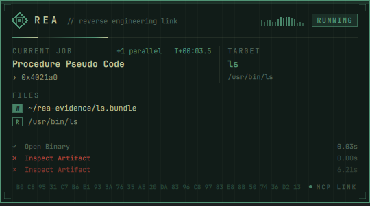

# REA HUD for Omarchy

An animated, theme-aware drop-down HUD for the [Omarchy](https://omarchy.org/) shell that shows what [REA](https://github.com/morluto/rea) is doing whenever Claude Code runs a reverse-engineering tool: the current job, its status and timer, the target binary, the files involved, and a log of recent jobs.



It drops down top-center under the bar, like Omarchy's calendar and weather panels, while any `mcp__rea__*` tool call is running. It retracts a few seconds after the last one finishes. It picks up your Omarchy theme's colors, font, borders, and corner rounding automatically, and clicks pass straight through it.

## Requirements

- Omarchy with the Quickshell-based Omarchy shell (`omarchy plugin` command available)
- [Claude Code](https://claude.com/claude-code) with the REA MCP server registered under the name `rea`
- `python3`

## Install

```bash
omarchy plugin add https://github.com/GPTmadeit/omarchy-rea-hud.git --enable
~/.config/omarchy/plugins/gptmadeit.rea-hud/install-hooks.sh
```

The first command installs the shell plugin. The second adds three Claude Code hooks (`PreToolUse`, `PostToolUse`, `PostToolUseFailure`, matching `mcp__rea__.*`) to `~/.claude/settings.json`, after backing it up. Restart any running Claude Code sessions afterwards.

If the HUD doesn't appear on first install, run `omarchy restart shell`.

## Update

```bash
omarchy plugin update gptmadeit.rea-hud
omarchy restart shell
```

The panel stays loaded for the whole shell session, so code changes need a shell restart.

## Uninstall

```bash
~/.config/omarchy/plugins/gptmadeit.rea-hud/install-hooks.sh --uninstall
omarchy plugin remove gptmadeit.rea-hud
```

The hook command checks that the script exists before running it, so removing the plugin without unhooking first won't break Claude Code. It just leaves inert entries in your settings.

## What it shows

| Section | Contents |
|---|---|
| Header | Spinning reticle, activity meter, `RUNNING` / `COMPLETE` / `FAILED` status |
| Current job | Tool name, what it's acting on (address, symbol, query…), elapsed time, parallel job count |
| Target | The binary or artifact REA opened |
| Files | Paths passed to recent REA calls. **R** = input, **W** = output (exports, pulls, extracts) |
| Log | The last three finished jobs, with durations and errors |

The files list comes from the paths in each tool call's arguments, so it shows what REA was asked to read or write, not every file it touches internally. The R/W tag is guessed from the argument's name. The hex ticker in the footer is decoration.

## How it works

```
Claude Code ──hook──▶ rea-hud-hook.py ──▶ ~/.local/state/rea-hud/state.json ──watch──▶ Hud.qml
```

`rea-hud-hook.py` runs before and after every REA tool call and records the job in a small JSON state file, under a file lock so parallel calls are safe. It always exits 0 and never blocks a tool call. `Hud.qml` is an Omarchy shell `panel` plugin that watches the file and renders the card on a click-through layer-shell surface.

## Commands

```bash
omarchy-shell rea-hud pin     # keep the HUD on screen (toggle) — handy for theming
omarchy-shell rea-hud state   # running | lingering | idle
```

## License

MIT
